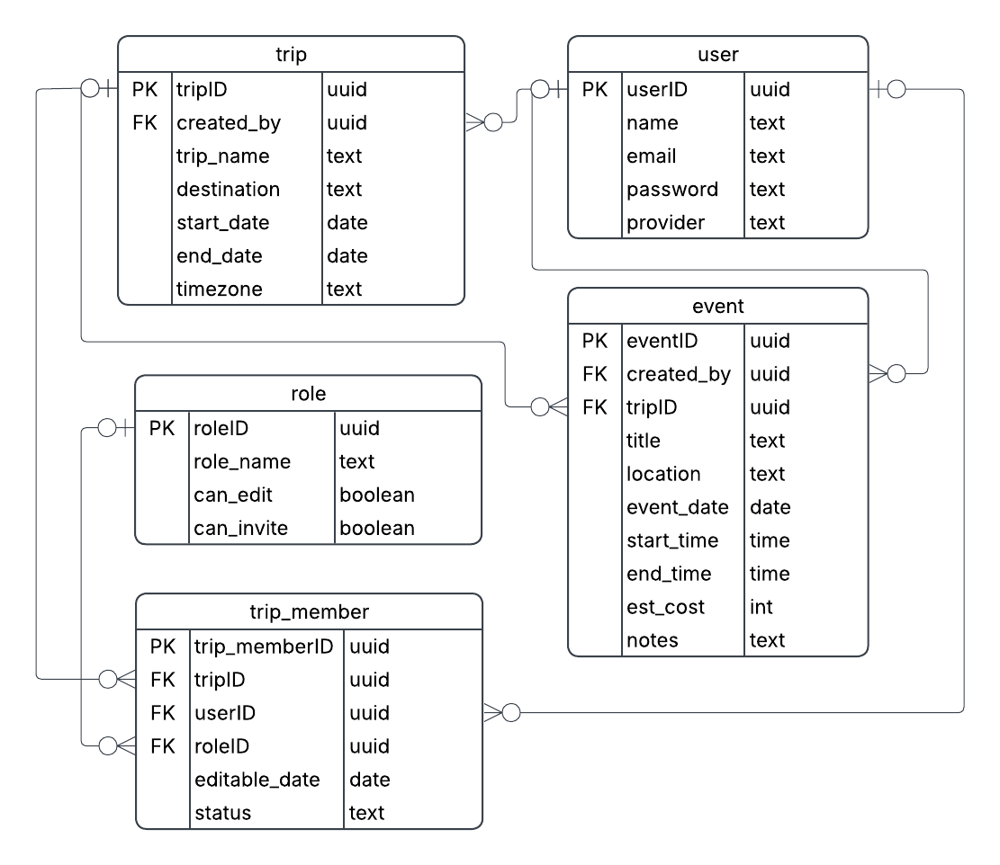

# Trip Planner

[Live app](https://danieltsao0103.github.io/trip-planner-prototype/) · [GitHub repository](https://github.com/DanielTsao0103/trip-planner-prototype) · [Demo video](https://www.loom.com/share/be0601e7285d4cf5876df31a91e2bba6)

## App Summary

Planning a group trip often means keeping track of messages, calendars, bookings, and shared expenses in different places. Trip Planner is for friends, families, and other groups who want those plans in one place. The app brings together trip dates, destinations, a day-by-day itinerary, group members, preferences, and budget screens. Travelers can explore a fictional Seattle and Bainbridge trip or create a separate trip in the prototype. Our working backend feature is email and password account creation, login, and sign-out through Supabase. Creating an account saves the account and its name in the database, then opens the planner with that person's name. Creating a trip now saves its name, destinations, dates, and time zone to the signed-in account in Supabase. Saved trips load after sign-in on another browser; editing trip details and deleting a trip also persist. Itinerary events, expenses, and invitation/group controls remain browser-only previews.

## Behavioral requirements and completion status

This release is scoped to the **Budget and Suggestions implementation-note cleanup**, not implementing every prototype feature. “Complete” means the behavior below is implemented and verified; it does not turn browser-only data into server data.

| Behavioral requirement | Status | Verification / boundary |
| --- | --- | --- |
| Hide implementation commentary on Suggestions, including its illustrative-data note and shared footer | Complete | Checked on desktop and mobile; suggestion controls remain available. |
| Hide implementation commentary on Budget, including its demo-finance note and shared footer | Complete | Checked on desktop and mobile; budget and expense controls remain available. |
| Preserve the existing notes on all other pages and dialogs | Complete | Restored the original copy; the shared footer remains on every other planner route. |
| Keep real-versus-simulated behavior documented for future development | Complete | [Implementation status](IMPLEMENTATION_STATUS.md) maps every screen to its actual persistence/integration boundary; source comments identify local mutations. |
| Keep the affected pages responsive and accessible | Complete | Desktop/mobile browser checks, keyboard dialog check, visual review, and Lighthouse results are recorded in [release verification](assignment/note-cleanup-verification.md). |
| Preserve the existing user → frontend → backend → database trip workflow | Complete | Live Supabase regression checks passed for browser creation, reload, fresh-browser sign-in, deletion, owner membership, validation, and account isolation; temporary test records were removed. This copy-only release needs no new API, table, or migration. |
| Save itinerary events, budgets, expenses, and survey answers to the backend | Not complete | These existing prototype features still use browser storage and are outside this release. |
| Deliver invitations/notifications or synchronize collaborator roles between real accounts | Not complete | Existing group controls are local previews; owner membership creation is the separate implemented database behavior. |
| Use real receipt OCR, Gmail/social integrations, recommendations, or payments | Not complete | Existing fixtures and previews remain; this release changes their visible commentary only on the two requested pages. |

The definition of done for this feature includes passing tests and Lighthouse Accessibility scores of at least 90, source on `main`, and deployment through the [Pages workflow](https://github.com/DanielTsao0103/trip-planner-prototype/actions/workflows/pages.yml) to the [public app](https://danieltsao0103.github.io/trip-planner-prototype/). The workflow verifies that live `version.json`, HTML, and JavaScript match the deployed commit.

## ERD



This is the team's original ERD, corrected in Lucidchart and exported after checking the live Supabase schema on October 10, 2026; see [Lucidchart Page 1](https://lucid.app/lucidchart/03d6d88e-7779-4ff9-ab5c-e40edb375353/edit?page=0_0). The image is the October 10 baseline. The October 28 account-trip slice adds `trip.owner_id`, `trip.destinations`, `trip.revision`, and an Owner role; the public tables are:

| Entity | What it stores | Screen connection |
| --- | --- | --- |
| `user` | Name, email, and provider for a person | Signup and account identity |
| `trip` | Original creator, owning Auth account, name, ordered destinations, dates, time zone, and revision | Trip creation and trip list |
| `event` | Creator, trip, title, location, date, times, estimated cost, and notes | Itinerary and Add event |
| `role` | Role name and edit/invite flags | Group permissions |
| `trip_member` | Trip, user, role, editable date, and membership status | Group travelers and assigned days |

A user can create many trips and events. A trip can contain many events and memberships. A user and a role can each appear in many memberships. `trip_member` connects users and trips as a many-to-many relationship. In crow's-foot notation, a circle means zero, a bar means one, and a crow's foot means many. The original six foreign keys allow NULL for legacy team records. New account trips require an authenticated owner, valid details, and an Owner membership. `owner_id` separately references `auth.users`; `created_by` retains the original creator profile. Legacy trips remain unassigned and are not exposed to new accounts. Each trip has one owner and many potential memberships; each membership links one user to one role. A unique trip/user key prevents duplicate membership, and a private trigger creates the Owner membership in the same transaction as the trip. Editors and viewers will be invited through a later feature; the current browser cannot grant membership or roles. Expenses, preference answers, and itinerary edits remain outside this backend slice.

Supabase also manages `auth.users`. On signup, a private trigger creates a `public.user` profile with the same UUID. Existing fictional group users are not automatically Auth accounts, and there is no foreign-key constraint from `public.user` to `auth.users`. The legacy `user.password` column remains in the team schema but is unused for new accounts; Supabase Auth handles password storage, and the browser cannot read that column.

See [Supabase setup](SUPABASE-SETUP.md) for the existing database configuration and schema history.

## Tech Stack

| Layer | Technology | Why it fits this project |
| --- | --- | --- |
| Frontend | React 19, TypeScript, CSS, and Vite 7 | Preserves the team's existing responsive screens; TypeScript checks data shapes before building. |
| Backend | Supabase Auth and its JavaScript client | Provides account creation, password checking, sessions, and sign-out without a separate custom server. |
| Database | PostgreSQL hosted by Supabase | Stores the five relational tables and Auth accounts; a database trigger creates the matching profile. |
| Hosting | GitHub Pages | Hosts the built frontend at the shared live-app link. Supabase runs the backend separately. |
| Development | Node.js, npm, and GitHub | A committed lockfile gives teammates the same dependencies and source version. |

This approach reuses our existing frontend and lets the team extend the backend one verified feature at a time. We can inspect both the code in GitHub and the tables in Supabase. The tradeoff is dependence on Supabase availability and plan limits; teammates should check the project's current usage before expanding it. Node.js runs development and build tools here, not a custom production API server. AI-assisted code generation does not replace the hosted database or backend.

## How to Get It Running

### Open the hosted app

1. Open the [live app](https://danieltsao0103.github.io/trip-planner-prototype/).
2. Use **Create an account** for the working database feature, or log in with an account you previously created.
3. **Try demo as Maya** is an optional local preview. It does not create a database account and is not the assignment's vertical slice.

### Run a fresh copy locally

1. Install Node.js 22.18 or newer with npm. Clone the repository and open a terminal in its project folder.

   ```sh
   git clone https://github.com/DanielTsao0103/trip-planner-prototype.git
   cd trip-planner-prototype
   ```

2. Install the locked dependencies:

   ```sh
   npm ci
   ```

3. Copy the configuration template:

   ```sh
   cp .env.example .env.local
   ```

   In `.env.local`, fill in `VITE_SUPABASE_URL` and `VITE_SUPABASE_PUBLISHABLE_KEY` using the existing team project's **Connect** dialog. The team project reference is `mzwydinhvgmwhnwlomnn`. An existing team member can provide the browser configuration if you lack dashboard access. Never put a secret key, service-role key, database password, or management token in a `VITE_` variable. Real environment files are ignored by Git.

4. Check the public connection, then start Vite:

   ```sh
   npm run supabase:check
   npm run dev -- --port 5190
   ```

5. Open [the local app](http://127.0.0.1:5190/). Keep the terminal running; press Control+C to stop. Restart Vite after changing environment variables. If Supabase is not configured, account actions are unavailable, but **Try demo as Maya** still opens the local preview.

6. Run the existing checks when changing code:

   ```sh
   npm test
   npm run build
   ```

The existing hosted database already has the tables, sample rows, and signup trigger. Do not rerun `supabase/migrations/20261010194129_auth_only_lucid_schema.sql`: it records a one-time correction to the team's existing project, not an initial database migration. See [Supabase setup](SUPABASE-SETUP.md) for details. No Python server or SQLite database is used by this version.

## Verifying the Vertical Slice

The current trip action is **Create trip** under a real signed-in account.

1. Create an account or log in with your email and password. Do not enter the Maya demo for this test.
2. Choose **New trip**, enter a title, destination(s), dates, and time zone, then select **Create trip**.
3. The form shows **Saving…** and only confirms success after Supabase returns the saved row. The trip card says **Saved to your account**.
4. Refresh, then sign in with that account in a private window. The trip remains available without the original browser's planner storage.
5. Open the trip, choose **Edit trip**, and save changed details. These details persist. A stale edit from another tab is rejected instead of overwriting newer changes.
6. Log in with a different account: it cannot see, edit, or delete the trip. Database row-level security enforces this even if the UI is bypassed.
7. Delete a test trip and refresh. Both the trip and its membership are removed.

```text
Trip form -> account-trips.ts -> Supabase Data API with the user's JWT
  -> RLS checks owner_id and created_by against auth.uid()
  -> database validates trip details
  -> trip insert + Owner membership trigger commit together
  -> saved row returns -> trip appears in the account
Fresh login -> read trips by owner_id -> account trip list
```

The database binds ownership to the authenticated UUID, never an email match or fictional participant. Only the browser-safe publishable key ships to the client; privileged keys stay in ignored server files. See [Supabase RLS documentation](https://supabase.com/docs/guides/database/postgres/row-level-security).

Failed loads offer retry instead of pretending the account is empty. Failed saves retain form input. A stable draft UUID prevents duplicate creation when a response is lost and retried. A revision check prevents stale edits and deletes. Existing browser-only trips are retained and labeled; saving their details from your real account explicitly stores them in Supabase. Local demo samples are never uploaded automatically.

**Scope:** trip details sync. Events, budgets, preferences, invitations, and fictional participant changes remain local. The Google/Apple buttons remain previews. The account-creation feature also remains active.

### Demo video and submission

[Watch the demo video](https://www.loom.com/share/be0601e7285d4cf5876df31a91e2bba6). Account creation, the returned account name, and refresh demonstrate the backend feature; the recording also shows the new account in Supabase. This historical video predates the account-trip slice; its trip and event walkthrough shows the older browser-local behavior. Record a new Create trip demo to demonstrate the current persistence feature.

Canvas requires a text entry with the demo video link and the public GitHub repository/README link, one submission per team. The video must be two minutes or less and focus on the vertical slice.

## Google Maps (optional)

The Map page and the Home map card show a real Google map when a Maps key is configured, and fall back to the illustrative demo map when it is not. Places from the trip's events are located with the Geocoding API and shown as numbered pins; the side panel links to walking directions in Google Maps.

1. In Google Cloud Console, create or choose a project, turn on billing, and enable **Maps JavaScript API** and **Geocoding API**.
2. Create an API key. Under **Application restrictions** choose **Websites** and allow `https://danieltsao0103.github.io/*` and `http://127.0.0.1:5190/*`. Under **API restrictions** limit it to those two APIs. A browser key is visible to anyone who opens the site, so these restrictions are what protect it. Set a low daily quota or budget alert.
3. Locally, put it in `.env.local` as `VITE_GOOGLE_MAPS_API_KEY` and restart Vite. For the live site, add the same name as a repository Actions variable and redeploy.

If the key is rejected or the script cannot load, the app switches to the demo map instead of showing a broken page.

## Database and Sample Data

The pre-recording database inspection on October 10, 2026 found 6 `user` rows, 2 `trip` rows, 2 `event` rows, 3 `role` rows, and 5 `trip_member` rows. These are hosted database counts, separate from the fictional fixtures in `src/data.ts`. One public profile matched an Auth account at that inspection; subsequent signups add more accounts and profiles. All five public tables have row-level security enabled. The October 28 migration enables owner-only trip CRUD, own/owned-trip membership reads, and authenticated role-definition reads. The event table remains inaccessible to the browser. Original rows were fingerprint-checked and preserved; the Owner role was added intentionally.

## Project Files

| Path | Purpose |
| --- | --- |
| `src/auth.tsx`, `src/supabase.ts` | Real email/password signup, login, session handling, and Supabase client |
| `src/main.tsx` | Connects the Auth session to the existing planner |
| `src/prototype.tsx`, `src/onboarding.tsx`, `src/planning.tsx` | Planner screens and navigation |
| `src/account-trips.ts`, `src/state.tsx` | Account trip persistence, loading, and local preview state |
| `src/demo-store.ts`, `src/data.ts` | Preserved browser-only saves and fictional samples |
| `src/finance.tsx`, `src/group.tsx`, `src/travelmap.tsx` | Budget, group, and illustrative map screens |
| `src/styles.css` | Responsive interface styling |
| `assignment/team-erd.png` | Team ERD verified against the existing five-table schema |
| `public/screens/` | Historical screenshot gallery; some screens predate real Auth |
| `SUPABASE-SETUP.md` | Existing-project configuration and schema history |

## Publishing

GitHub Actions runs `.github/workflows/pages.yml` on pushes to `main` and pull requests. It installs the locked dependencies, runs the unit tests, builds the site, and runs desktop/mobile browser tests. A passing main-branch build deploys `dist/` to GitHub Pages and checks the live `version.json` against the deployed commit. Set Pages source to **GitHub Actions** and configure repository Actions variables `VITE_SUPABASE_URL` and `VITE_SUPABASE_PUBLISHABLE_KEY` (and optionally `VITE_GOOGLE_MAPS_API_KEY`, see Google Maps above). Never add private credentials to those variables.

Commit source and assignment documentation; `docs/` and `dist/` are generated and ignored. Keep the README image in `assignment/team-erd.png` so it can be committed. Open app tabs offer **Reload app** when they detect a new release.

For production-browser checks from a Git checkout, use:

```sh
npm run build:pages
npx playwright install chromium
npm run test:e2e
```

For a source archive without Git metadata, set `GITHUB_SHA` to the commit the archive was downloaded from when running `npm run build:pages`. This keeps release metadata tied to the correct source.

The default browser suite mocks Auth and trip responses: it verifies frontend behavior, failure recovery, and session restoration, but does not itself prove a live database write. The opt-in `npm run test:live-trips` uses temporary accounts against the configured project and a running production preview; it verifies real trip/membership writes, cross-account isolation, fresh-browser persistence, and cleanup. Separate live Supabase signup, profile, and fresh-client login checks passed on October 10, 2026; the temporary QA account was removed and original records were unchanged. Follow the real-account steps above to verify the backend feature.

## Assets

Travel photos are bundled from Unsplash; [its license](https://unsplash.com/license) applies. Seattle skyline: `photo-1438401171849-74ac270044ee`; ocean: `photo-1518837695005-2083093ee35b`; city: `photo-1477959858617-67f85cf4f1df`; dining: `photo-1414235077428-338989a2e8c0`; artwork: `photo-1561214115-f2f134cc4912`. Other than the skyline, photos are mood imagery rather than verified venue images. DM Sans and Fraunces come from Fontsource; icon artwork uses Lucide. Bundled licenses are in `public/licenses/`, and provider-artwork sources are in `src/assets/auth/SOURCES.md`. Sample travelers, bookings, expenses, and permissions are fictional.

## Account-trip verification (October 28, 2026)

The live SDK/browser checks passed for atomic owner membership, duplicate retries, validation, stale edits, anonymous/cross-account denial, browser creation, fresh-browser login, and deletion. Temporary QA accounts and their data were removed. Supabase's hosted security-advisor endpoint was unavailable to the configured scoped token (`advisors_read` missing); direct database access checks and adversarial API tests were performed. See [Supabase setup](SUPABASE-SETUP.md) for migration boundaries.
