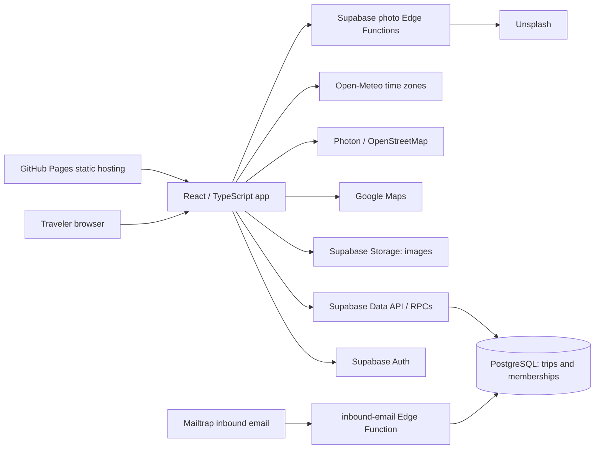

# Trip Planner

Trip Planner brings group trips, itineraries, shared maps, traveler preferences, and budgets into one app. Signed-in accounts save their trips to Supabase and can invite collaborators; the fictional Maya/Seattle sample remains separate in browser storage.

[Live app](https://danieltsao0103.github.io/trip-planner-prototype/) · [GitHub repository](https://github.com/DanielTsao0103/trip-planner-prototype)

**System overview updated November 9, 2026**, against source revision `7380a57`. This README describes the current implementation. Linked acceptance reports record checks performed on their stated dates and revisions; this documentation update is not a new live-service audit.

## Current features

| Area | Implemented behavior |
| --- | --- |
| Accounts | Email/password signup, login and sign-out; Google OAuth; persistent sessions; account name and password editing; profile picture upload, replacement and removal. Provider accounts manage their password with their provider. |
| Trips | Create, list, edit and delete account trips; multiple ordered destinations and destination time zones; optional Unsplash or uploaded covers; copy curated trip templates into a trip. |
| Itinerary | Events with locations, dates, times, costs, notes, attendees and pictures; daily list and seven-day calendar; drag or use the Move dialog to reschedule while preserving duration. |
| Collaboration | Email invitations for existing and new accounts; trip-preserving authentication and post-join preferences; Viewer, Editor and Day Editor access enforced by the database. |
| Maps | Google road/satellite maps, itinerary pins, automatic location resolution, saved coordinates/place IDs, pin adjustment and links to the matching daily itinerary item. |
| Preferences | Each accepted traveler can save their own survey; the group can view aggregated preferences. |
| Budget | Group and individual budgets, tracking mode, expenses, split allocations and repayment markers stored in relational tables. Money is stored in integer cents. |
| Reminders | Trip reminders and completion state persist. Dismissed suggestion IDs also persist; suggestion content is still illustrative. |
| Appearance | Account theme, light/dark mode, heading font and corner preferences save to Supabase; demo styling stays local. |
| Save recovery | Serialized autosaves, atomic owner writes, revision checks, transient retries, validated recovery journals and visible failure/download controls. |

### Permissions and invitations

Each trip has one owning Auth account. Guest traveler records are distinct from authenticated memberships; a matching email or the demo participant selector never grants account access.

| Role | Allowed actions |
| --- | --- |
| Owner | Manage the trip, invitations, roles, group settings and budgets, plus itinerary content. |
| Editor | Edit itinerary events and reminders across the trip. |
| Day Editor | Edit events and reminders on assigned dates; moving an event requires permission on both its original and destination dates. |
| Viewer | Read the shared trip without editing events or reminders. |

Accepted travelers can also manage their own preferences, expenses and individual budget within the server's validation rules. Only the owner grants Editor or Day Editor access; invited accounts start as Viewers.

Invitations require configured email delivery. Existing-account invitations are tied to the invited account; eligible new-account invitations preserve the trip while the traveler chooses signup, login or an enabled social provider. After joining, the traveler opens that trip's preference survey. New invitation links last seven days; resending replaces the previous link. Accepted memberships do not expire with the invitation.

### Itinerary, maps and photos

- Calendar moves use the event's top edge and round to the nearest minute. The Move dialog supports keyboard and touch use. Trip dates, overlaps and edit permissions are checked before saving.
- Photon/OpenStreetMap supplies destination and event-location suggestions. Searches can favor a selected trip stop or use worldwide results; manual entry remains available. Open-Meteo helps resolve destination time zones from coordinates.
- Google Maps resolves typed itinerary locations and unpinned existing events. Saved manual positions take priority. Named areas can show a center pin; unresolved locations are edited in the itinerary.
- Account screens refresh shared trip data every five seconds while visible and on focus/reconnect, while preserving pending local edits. This uses foreground polling, not a Supabase Realtime subscription. Device location and map viewport stay local.
- Trip covers and itinerary pictures support Unsplash selection and custom uploads. Cover search offers up to five landscape matches; JPEG, PNG and WebP uploads accept files up to 5 MB. Unsplash credit and selection tracking are retained. Uploaded trip and profile images use public Storage buckets, so anyone with an image URL can view it.
- The event editor's popular-times link opens a Google Maps search; it does not fetch crowd data into the app.

## Architecture

The customer app is **React 19 + TypeScript**, built with **Vite 7** and hosted on **GitHub Pages**. Node.js runs development, build and test tools; there is no deployed Express server for the current customer app.



Supabase Auth identifies the signed-in account. Database policies and membership-checked RPCs enforce authorization independently of the UI. Supabase Storage holds images; Edge Functions handle photo services and the separate rule-based booking import. External features depend on their service configuration.

### Persistence and recovery

All account-trip screens use the shared state and save queue:

```text
Screen edit → state.tsx → TripSaveQueue → account-trips.ts
  Owner:        save_account_trip
  Collaborator: save_shared_trip_changes
  → server permission and revision checks → transaction → validated saved bundle
```

Owner saves commit trip content, ordered destination time zones and cover-photo credit together. Read bundles include consistent root, child and photo data. The client only acknowledges a save after receiving a complete, valid response for the expected trip. A brief “Changes saved” notification follows confirmed writes; failed or pending writes do not report success.

Revision checks reject stale writes rather than overwrite newer work. Retry handling prevents a lost response from duplicating a completed save. Failed loads show an error and retry option instead of an empty account. Unsaved changes retry after temporary failures or reconnect; conflicts retain recovery controls instead of merging automatically.

Browser storage contains sample trips and temporary account recovery records, not the authoritative saved account trip. Each tab holds a Web Lock for its recovery writer; another tab can adopt a journal only after ownership becomes available. Recovery data is validated before loading, replacement records are stored before predecessors are removed, and confirmed saves retire their recovery records. Invalid records remain available for download. Storage failures show a warning; browsers without Web Locks cannot safely adopt another tab's journal.

Concurrent whole-trip edits can still conflict, even when they affect different events. Clearing browser storage can erase unsaved recovery data. See [Persistence contract](PERSISTENCE_CONTRACT.md) for the required write path, field-extension checklist and release checks.

## Database model

The schema is relational, with account ownership separated from guest traveler identities.

| Tables | Purpose |
| --- | --- |
| `auth.users`, `public.user` | Authentication and public profiles, including account/profile picture metadata. Passwords belong to Supabase Auth. |
| `trip`, `trip_destination_timezone`, `trip_photo_credit` | Trip details, owning Auth UUID, revision, ordered destination zones and cover attribution. |
| `role`, `trip_member`, `trip_member_day` | Role definitions, guest or linked-account membership, status and editable dates. |
| `event`, `trip_event_attendee` | Itinerary content, pictures, map coordinates/place IDs and attendance. |
| `trip_expense`, `trip_expense_share`, `trip_person_budget` | Expenses, allocations/repayment markers and individual budgets; group budget/mode live on `trip`. |
| `trip_preference`, `trip_todo`, `trip_dismissed_suggestion` | Traveler surveys, reminders and dismissed ideas. |
| `user_style`, `user_style_log` | Appearance preferences and their change history. |
| `forwarded_booking`, `inbound_email_log` | Extracted booking fields and inbound-message deduplication. |
| Private invitation tables | Invitation requests, expiry and acceptance proof. |

New account trips create their owner membership atomically. Legacy team records are not assigned to a new account by email inference. Removed travelers retain references needed for financial history. Shared writes validate the actual changed records against current membership and role permissions.

[Original team ERD](assignment/team-erd.png) · [Lucidchart Page 1](https://lucid.app/lucidchart/03d6d88e-7779-4ff9-ab5c-e40edb375353/edit?page=0_0)

The original ERD is the **October 10 five-table baseline**, not the complete current schema. Later changes are recorded in [Supabase migrations](supabase/migrations/), including the atomic-save and consistent-snapshot migrations dated November 9 UTC.

## Run locally

Use **Node.js 24** to match CI, and npm.

```sh
git clone https://github.com/DanielTsao0103/trip-planner-prototype.git
cd trip-planner-prototype
npm ci
cp .env.example .env.local
```

Fill in `.env.local` using the existing team's service configuration:

| Variable | Purpose |
| --- | --- |
| `VITE_SUPABASE_URL` | Existing Supabase project URL. |
| `VITE_SUPABASE_PUBLISHABLE_KEY` | Browser-safe `sb_publishable_` key for Auth and account data. |
| `VITE_GOOGLE_MAPS_API_KEY` | Website-restricted Google Maps browser key. |
| `VITE_GOOGLE_MAP_ID` | Optional custom Google map style. |
| `VITE_BOOKINGS_INBOX_ADDRESS` | Optional forwarding address displayed on Home; leave blank to hide it. |

```sh
npm run supabase:check
npm run dev -- --port 5190
```

Open [the local app](http://127.0.0.1:5190/). Restart Vite after environment changes. Without Supabase configuration, **Try demo as Maya** still opens the local preview. Google Maps and other external features need their own configuration.

Never put service-role/secret keys, management tokens, SMTP credentials or database passwords in `VITE_` variables. Real environment files are ignored. Private QA/admin scripts use separate ignored files; see [Supabase setup](SUPABASE-SETUP.md), whose dated sections also preserve historical setup steps.

This checkout connects to an existing team database. The migration directory is **not a standalone fresh-project bootstrap**: `20261010194129_auth_only_lucid_schema.sql` records a one-time correction and must not be rerun against the current project. Inspect deployed migration state before database changes. Current clients require the atomic save/read contract; a mismatched database produces an explicit recoverable error.

Email invitations require SMTP and Auth redirect/template configuration. Photo search uses the existing `unsplash-search` service and the tracked `unsplash-track` function; the search function's implementation is not bundled here. Unsplash and Mailtrap secrets belong on the server. Running the frontend does not provision these services.

## Tests and deployment

```sh
npm test                       # Domain, persistence, recovery and inbound parser tests
npm run build                  # TypeScript check and local production build
npm run build:pages             # Pages base path, credential scan and version metadata
npx playwright install chromium webkit
npm run test:e2e                # Built-app browser regression checks
```

Browser tests use the Pages build and launch a preview server. Set `PLAYWRIGHT_PORT` to an unused port when another preview is running. Projects cover desktop/mobile Chromium plus a focused WebKit persistence suite. API-mocked browser tests do not prove hosted database authorization or email delivery.

Live checks require the configured team project and ignored QA credentials, create disposable accounts/records, and attempt cleanup:

```sh
npm run test:live-contract      # Atomic save/read, retry and concurrency contract
npm run test:live-persistence   # Full relational trip persistence
npm run test:live-trips         # Account-trip browser flow; preview on port 4173
```

Follow [Persistence contract](PERSISTENCE_CONTRACT.md) before publishing persistence changes. Live database suites are an explicit pre-release step, not part of GitHub Actions; CI does not have the privileged database test secret.

The [Pages workflow](.github/workflows/pages.yml) runs unit tests, TypeScript/build checks and Playwright. Successful pushes to `main` deploy the built `dist/` artifact, then verify live `version.json`, HTML and JavaScript against the exact commit. Pull requests run checks without deploying. Source files are authoritative; generated `dist/` and old `docs/` are not source.

### Manual acceptance flow

1. Sign in with a real account, create a trip and wait for confirmed saving.
2. Add an event, preferences, budget/expense and reminder; reload and verify the data in another signed-in browser.
3. Invite a controlled second account. Verify email delivery, acceptance into the correct trip, the preference survey and saved answers.
4. Confirm Viewer restrictions, then grant Editor or Day Editor and check allowed edits plus forbidden date moves. Verify the owner sees saved changes.
5. Interrupt a save, check recovery/retry behavior, and confirm a competing newer revision is not overwritten. Check that failures retain an unsaved download.
6. Remove the collaborator and verify access is revoked; delete the test trip and confirm it stays deleted after reload.

### Recorded verification

These are historical reports with explicit scope, revisions and verification boundaries:

| Report | Coverage |
| --- | --- |
| [November 8 Done-card checks](assignment/done-cards-verification-2026-11-08.md) | Invitations, itinerary pictures, collaborator preferences, budgets and permissions. |
| [November 8 live group acceptance](assignment/live-group-acceptance-2026-11-08.md) | Real invitation delivery/acceptance, preference isolation and database role enforcement. |
| [November 7 photos and budgets](assignment/photos-budget-definition-of-done-2026-11-07.md) | Live storage/database readback, reload, responsive layouts and Lighthouse checks. |
| [November 7 sprint audit](assignment/sprint-definition-of-done-2026-11-07.md) | Earlier seven-feature audit; later reports supersede gaps they explicitly rechecked. |
| [Trip persistence](assignment/trip-persistence-verification.md) | Original full-detail persistence acceptance. |
| [Field limits](assignment/field-limits-verification.md) and [copy cleanup](assignment/note-cleanup-verification.md) | Earlier scoped releases. |

“Complete” in a report applies to its checked feature and revision, not every prototype integration. Historical Lighthouse scores are not a new audit of the current build.

## Not complete and planned work

| Feature | Current boundary |
| --- | --- |
| Apple sign-in | Not enabled on the hosted project; email/password and Google are the available paths. |
| Email change and account deletion | Not built. |
| Automatic concurrent-edit merging | Not built; revisions detect conflicts and preserve recovery choices. |
| Recommendations and nearby alerts | Illustrative suggestions/proximity fixtures, not live recommendations, background geofencing or delivered notifications. |
| Banking and payments | Expense splits and repayment markers persist, but no bank connection or money movement occurs. |
| Gmail/social connections and receipt OCR | Connection/receipt previews do not represent live inbox access or OCR. |
| Forwarded bookings | Rule-based Mailtrap import exists, but bookings are not attached to trips. Sender matching is unverified and parsing can be incomplete. Availability depends on deployed service configuration. |
| Admin portal and AI receipt processing | Planned only; no deployed admin server, AWS database or automated receipt-review workflow. |

The proposed receipt flow is: **traveler emails a receipt and trip reference to a dedicated Gmail inbox → automation/AI extracts a draft → admin reviews it → authorized server writes an approved expense to Supabase → traveler sees it in the app**. It does not scan a traveler's personal inbox. Proposed admin hosting is Express/Node.js on AWS Elastic Beanstalk, with RDS PostgreSQL for processing/review records; customer trip data stays in Supabase. Automation and AI/OCR providers remain undecided.

[Architecture illustration with planned receipt flow](assignment/system-architecture.png) · [SVG](assignment/system-architecture.svg) · [FigJam](https://www.figma.com/board/I4HBVhgTCyki0lvjDZyMZ8/Untitled?node-id=44-271)

The illustration includes planned components and predates the latest persistence hardening. The architecture and persistence sections above describe the current source. [Implementation status](IMPLEMENTATION_STATUS.md) provides the detailed screen inventory and dated service notes.

## Project guide

| Path | Purpose |
| --- | --- |
| `src/auth.tsx`, `src/supabase.ts`, `src/main.tsx` | Authentication, client configuration and app entry. |
| `src/state.tsx`, `src/account-trips.ts`, `src/trip-save-queue.ts` | Shared state, validated RPC boundary and serialized account saves. |
| `src/trip-recovery-validation.ts`, `src/account-trip-sync.ts` | Recovery validation and foreground shared-trip refresh. |
| `src/domain.ts`, `src/limits.ts` | Typed domain rules and input limits. |
| `src/planning.tsx`, `src/weekly-calendar.tsx`, `src/travelmap.tsx` | Itinerary, calendar and maps. |
| `src/finance.tsx`, `src/group.tsx` | Budgets, expenses, members and preferences. |
| `src/account-page.tsx`, `src/profile-picture.ts`, `src/style-page.tsx` | Account settings, pictures and appearance. |
| `src/demo-store.ts`, `src/data.ts`, `src/preplanned-trips.ts` | Browser-only demo state and curated fixtures/templates. |
| `supabase/migrations/`, `supabase/functions/`, `supabase/templates/` | Database evolution, tracked Edge Functions and invitation email template. |
| `tests/`, `src/*.test.ts`, `scripts/` | Browser/unit tests, live verification and build/deployment utilities. |
| `assignment/` | Historical ERD, architecture illustrations and acceptance evidence. |

## Coursework demo

[Original demo video](https://www.loom.com/share/be0601e7285d4cf5876df31a91e2bba6) demonstrates the earlier signup/profile slice. It predates current account-trip persistence and collaboration; its browser-local itinerary behavior is historical. A current demonstration should follow the manual acceptance flow above. The recorded assignment instructions call for a video of two minutes or less and one team Canvas text submission containing the video and public repository/README links.

### Budget currency converter

The Budget page keeps balances and the expense ledger first. Its 37-currency converter, including South Korean won (KRW), is collapsed at the bottom and opens from **USD · Convert**; closing it preserves entered values. [Frankfurter](https://frankfurter.dev/) supplies current reference rates without an API key or paid plan. The page refreshes rates once a week while open or when you return after the cached rate expires, with a manual refresh button, publication date, and clearly labeled saved-rate fallback during outages. These are planning estimates; banks/card issuers may use different rates and fees. Budgets and recorded expenses remain in USD. See `IMPLEMENTATION_STATUS.md` for freshness and failure rules.

Complete: standalone conversion, currency swapping, current-rate lookup, automatic/manual refresh, validation, and desktop/mobile failure coverage. Not included: foreign-currency expense accounting or bank/card-specific conversion rates.

Budget usability: saved expenses expose split details on demand; repayments are grouped by traveler with unpaid subtotals and relationship filters. The mobile chart and sample tools are optional disclosures, and repayment confirmations identify the traveler. The converter keeps its weekly refresh policy and does not alter recorded USD expenses.

Budget follow-up: the mobile breadcrumb fits one row, expense splits explain rounding when needed, and the shared-expense Save action remains visible in shorter dialogs. Reimbursements open on money owed to you; the relationship filter still exposes all repayments. Independent simulated review rounds informed these refinements; agent ratings are not human-user research.

UX refinements: the ledger keeps Expense log, Repayments, and Add together on phones; Add expense retains its full accessible name and card-header location. Repayment totals expand into individual records, and their spending chart starts collapsed. Shared-payment guidance appears only after opting into a split. Form actions and repayment explanations use larger text; converter keyboard order reaches the amount before rate-refresh controls.


Budget UI/UX refinements: tablet layouts give the ledger full width and keep the breakdown collapsed initially. Expense forms scroll their fields separately from the fixed action row, keeping focused choices visible in short viewports. Readable dates and grouped metadata reduce scanning effort; category labels sit beside their controls. Repayments expose the filtered unpaid total and indent individual details with nearby actions. Transient Budget confirmations appear inline above the ledger rather than covering rows; existing account-save confirmation timing remains unchanged. The converter stays optional, at the bottom, with weekly rate checks. Simulated UI and UX ratings remain separate from engineering checks and human-user evidence.
