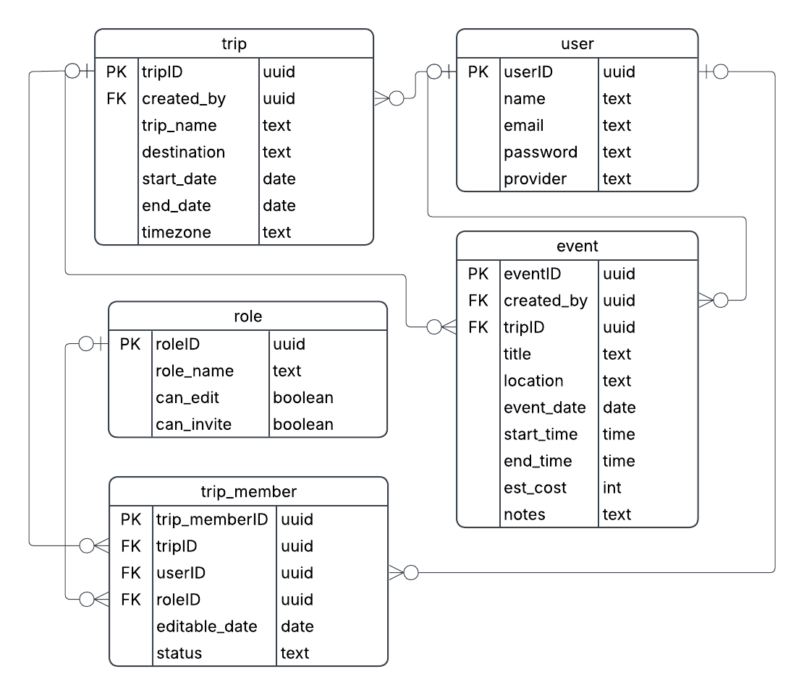

# Trip Planner

## Trip photos: behavioral requirements and completion status

The trip form searches the first added destination through the Supabase `unsplash-search` Edge Function by default. For a trip with multiple destinations, the user can choose which destination to search. It offers two to five landscape photos when enough matches are available, or the user can upload a JPEG, PNG, or WebP photo under 5 MB. The client requests up to 30 search results and filters by photo dimensions because the deployed search function does not currently forward Unsplash's orientation filter. Uploaded photos go to the public `trip-photos` Supabase Storage bucket, and the selected URL is saved with the account trip. Unsplash photographer and photo links are saved in `trip_photo_credit` and shown beside the cover. The `unsplash-track` Edge Function calls the selected photo's exact Unsplash `download_location` when it becomes a cover; its public-key-only request also works for browser-only demo trips.

Apply `supabase/migrations/20261029120000_trip_photos.sql`, set `Unsplash_Key` as a Supabase Edge Function secret, and deploy `supabase/functions/unsplash-track`. The existing `unsplash-search` function must accept a GET request with `query` and `per_page` and return Unsplash's `results` array (or the array directly). The browser needs the usual `VITE_SUPABASE_URL` and `VITE_SUPABASE_PUBLISHABLE_KEY` values. Do not put the Unsplash key in a `VITE_` variable or commit it. A public Storage bucket means anyone with an uploaded photo's URL can view that photo.

| Behavioral requirement | Status | Verification / boundary |
| --- | --- | --- |
| Search the first added destination automatically; show a destination dropdown only when two or more destinations are added | Complete | Desktop/mobile browser tests check the dropdown, default choice, switching, and removal. |
| Offer two to five landscape Unsplash photos for the chosen destination | Complete | The client requests up to 30 results, rejects images whose width is not greater than their height, and displays at most five. Browser tests cover portrait rejection and both result limits. The deployed search proxy ignores `orientation`, so the filtering currently happens in the client. |
| Keep photo selection optional and allow a custom cover upload | Complete | The form accepts JPEG, PNG, or WebP files up to 5 MB. Account uploads use the `trip-photos` bucket; the browser-only demo requires sign-in before an upload can be saved. If fewer than two suitable Unsplash photos remain or search fails, the upload control stays available. |
| Save the chosen cover with the trip and retain Unsplash credit | Complete | Account saves send the image URL through `save_trip_bundle` to the trip's `image_url`, retain photographer and photo links in `trip_photo_credit`, and register a selected Unsplash photo through `unsplash-track`. Demo saves keep the chosen cover in the browser and also register the Unsplash selection. The picker shows one linked Unsplash caption above the grid and linked photographer names under photos. Existing covers and custom uploads are not automatically cropped or replaced. |

[Live app](https://danieltsao0103.github.io/trip-planner-prototype/) · [GitHub repository](https://github.com/DanielTsao0103/trip-planner-prototype) · [Demo video](https://www.loom.com/share/be0601e7285d4cf5876df31a91e2bba6)

## App Summary

Planning a group trip often means keeping track of messages, calendars, bookings, and shared expenses in different places. Trip Planner is for friends, families, and other groups who want those plans in one place. The app brings together trip dates, destinations, a day-by-day itinerary, group members, preferences, and budget screens. Travelers can explore a fictional Seattle and Bainbridge trip or create a separate trip in the prototype. Our working backend feature is email and password account creation, login, and sign-out through Supabase. Creating an account saves the account and its name in the database, then opens the planner with that person's name. Creating a trip now saves its name, destinations, dates, and time zone to the signed-in account in Supabase. Saved trips load after sign-in on another browser; editing trip details and deleting a trip also persist. Events and attendees, guest travelers and role/day settings, preferences, budgets, expenses and split/repayment records, reminders, and dismissed suggestions also save to the account. Sample trips remain local. Owners can share trips with registered accounts by email. Account setup invitations use Supabase Auth email links and require a configured outbound SMTP sender.

## System Architecture


[Open full-size diagram](assignment/system-architecture.png) · [Scalable SVG copy](assignment/system-architecture.svg) · [FigJam board — Diagram frame](https://www.figma.com/board/I4HBVhgTCyki0lvjDZyMZ8/Untitled?node-id=44-271)

Solid green paths show connections implemented in source; dashed amber paths show planned connections. Service configuration may still be required; this diagram is a source review, not a fresh live-service audit. The current map uses the Google Maps JavaScript API; Photon/OpenStreetMap provides destination search with a bundled GeoNames fallback. Supabase Auth handles email/password and the implemented Google OAuth flow. Its Data API/RPCs read and save account trips in PostgreSQL, while Supabase Storage holds uploaded cover photos. Edge Functions connect to Unsplash for photo search/selection tracking and Mailtrap for existing rule-based forwarded booking imports. The React frontend was built with AI assistance and is hosted on GitHub Pages; Node.js currently runs build tools, not a deployed application server.

The **admin portal is planned**: HTML/CSS pages served by an Express/Node.js server on AWS Elastic Beanstalk, with Amazon RDS PostgreSQL storing receipt drafts, review status, and audit records. These AWS services are proposed hosting choices, not deployed resources. The server will validate admin access and connect to Supabase for authorized trip lookups and approved expense writes. Supabase stays the source of truth for customer trip data; RDS stores the admin processing records.

The **AI receipt workflow is planned**: a traveler emails a receipt and trip reference to a dedicated Gmail inbox. An automation retrieves the message and attachment, calls an AI/OCR service to extract merchant, date, total, and currency, and submits a draft to the admin server. After an admin reviews or corrects it, the server saves the approved expense to the matching Supabase trip; the customer sees it on the next trip load. Matching must verify account/trip authorization, and repeated emails must not create duplicate expenses. The automation platform and AI/OCR provider are still to be selected; the inbox and workflow are not configured yet. This workflow receives emailed receipts; it does not scan a traveler's entire personal inbox.

Existing Mailtrap booking imports are separate from the planned Gmail receipt workflow: they use rule-based parsing, store unverified booking fields, and do not attach bookings to trips or perform AI expense extraction. Apple sign-in, social connections, bank matching, and payments remain outside this implementation plan; their preview UI does not indicate a live service connection. Current implementation boundaries are listed in [Implementation status](IMPLEMENTATION_STATUS.md).

## Trip persistence: behavioral requirements and completion status

Scope: the full account-trip persistence task only. The six definition-of-done checks and their evidence are recorded in [trip-persistence verification](assignment/trip-persistence-verification.md). This does not expand the suggestion engine or implement unrelated integrations.

**Definition of done: Complete.** Desktop/mobile layouts passed 42 state audits and 32 width checks; the hosted user-to-database flow passed 90 checks; Lighthouse Accessibility scored **95–100** across 42 checks. The behavioral requirements are marked below, the implementation is on `main`, and the [public app](https://danieltsao0103.github.io/trip-planner-prototype/) serves it. See the linked report for exact versions and remaining out-of-scope work.

| Behavioral requirement | Status | Verification / boundary |
| --- | --- | --- |
| Create, list, edit and delete a trip under the signed-in owning account | Complete | Live UI → Supabase API → PostgreSQL checks; exactly one owner membership and account isolation. |
| Save destinations, dates, time zone, image URL, events, locations, times, costs, notes and attendees | Complete | Complete database round-trip; event add/edit/delete and fresh-browser reads. |
| Save guest travelers, names/emails, roles, editable days and removal state | Complete | Guest IDs remain separate from Auth IDs; removed travelers retain financial history. |
| Save all survey answers, group/individual budgets, expenses, split shares and repayment markers | Complete | Live field-by-field readback, odd-cent splits, budget-mode switching and protected completed repayments. |
| Save reminders, completion state and existing dismissed suggestion IDs | Complete | Create/update/delete, reload and database checks. Recommendation generation is unchanged. |
| Replace permanent browser copies of account trips with database storage | Complete | Samples remain local; only unsaved recovery drafts are retained for account trips, then removed on success. |
| Preserve older browser details for an already-owned database trip | Complete | One-time import remaps legacy IDs and preserves historical allocations; email does not establish ownership. |
| Prevent partial writes and silent overwrites; visibly recover from failed saves | Complete | Transaction rollback, concurrent revisions, lost responses, explicit retry/reload and draft download tested. |
| Deliver cross-account editing, file uploads/OCR, messages or payments | Not complete | Outside this task; stored guest roles do not grant another account access, and uploaded file previews are temporary. |

## Field limits: behavioral requirements and completion status

Historical field-limit release scope: character and money limits, verified through the account-trip save path. The separate persistence release below now extends database saving to events, budgets, preferences, guest travelers, and reminders.

| Behavioral requirement | Status | Verification |
| --- | --- | --- |
| Limit trip/event titles to 100 characters, trip destinations/event locations to 220, names to 90, and email inputs to 280 | Complete | Native input limits plus save-handler validation; email format validation still applies. |
| Limit event/additional notes to 2,200 characters, preference places to 1,100, expense descriptions to 130, and reminders to 220 | Complete | Desktop/mobile boundary tests check pasted input, saves, and reloads. |
| Limit bulk invitation text to 5,600 characters and 20 addresses; limit trips to 20 destinations | Complete | Individual addresses, total text length, and item counts are validated before saving. |
| Show accessible character counts and preserve existing oversized text until the user edits it | Complete | Counters are linked with aria-describedby; oversized saved notes remain intact and cannot be resaved until shortened. |
| Limit group/individual budgets to $999,999.99 and expenses/event estimates to $99,999.99, with at most two decimal places | Complete | Form and save validation reject excessive amounts, extra decimals, exponents, and non-finite values; free event estimates remain allowed. |
| Persist the new 100/220 trip limits through User → Frontend → Supabase → PostgreSQL | Complete | Live mobile creation, database readback, fresh-browser sign-in, editing, and reload passed; direct oversized API writes were rejected without changing the saved row. Temporary test records were removed. |
| Keep changed forms responsive and at or above Lighthouse Accessibility 90 | Complete | Verified desktop/mobile screenshots, 320–1365px layout checks, and Lighthouse results in [field-limit verification](assignment/field-limits-verification.md). |
| Deliver the field-limit source on main at the public URL | Complete | Implementation commit 9eb8ea6 is on main and live; the Pages workflow verifies the published revision. |

The task's six definition-of-done checks, scores, and repeatable commands are recorded in [field-limit verification](assignment/field-limits-verification.md). Existing backend features outside this task retain their separate **Not complete** statuses below.

## Budget and Suggestions copy cleanup: behavioral requirements

The current release extends account-trip persistence to all structured planning details. It also preserves the previously published Budget/Suggestions copy cleanup and Home navigation highlight.

| Behavioral requirement | Status | Verification / boundary |
| --- | --- | --- |
| Hide implementation commentary on Suggestions, including its illustrative-data note and shared footer | Complete | Checked on desktop and mobile; suggestion controls remain available. |
| Hide implementation commentary on Budget, including its demo-finance note and shared footer | Complete | Checked on desktop and mobile; budget and expense controls remain available. |
| Preserve the existing notes on all other pages and dialogs | Complete | The shared footer remains on every other planner route; storage wording now reflects database persistence. |
| Keep real-versus-simulated behavior documented for future development | Complete | [Implementation status](IMPLEMENTATION_STATUS.md) maps every screen to its actual persistence/integration boundary; source comments identify the database and simulation boundaries. |
| Keep the affected pages responsive and accessible | Complete | Desktop/mobile browser checks, keyboard dialog check, visual review, and Lighthouse results are recorded in [release verification](assignment/note-cleanup-verification.md). |
| Preserve the existing user → frontend → backend → database trip workflow | Complete | Live Supabase regression checks passed for browser creation, reload, fresh-browser sign-in, deletion, owner membership, validation, and account isolation; temporary test records were removed. The full-detail extension adds reviewed relational tables and atomic save/load RPCs. |
| Save itinerary events, budgets, expenses, and survey answers to the backend | Complete | Full database round-trip and real browser/fresh-browser checks; reminders, attendees, guest roles/days, split shares, and repayments also persist. |
| Share a trip by email | Partial | Registered accounts receive Viewer access. New-account emails require configured outbound SMTP. |
| Use real receipt OCR, Gmail/social integrations, recommendations, or payments | Not complete | Existing fixtures and previews remain; the persistence release does not expand these integrations. |

The definition of done for this feature includes passing tests and Lighthouse Accessibility scores of at least 90, source on `main`, and deployment through the [Pages workflow](https://github.com/DanielTsao0103/trip-planner-prototype/actions/workflows/pages.yml) to the [public app](https://danieltsao0103.github.io/trip-planner-prototype/). The workflow verifies that live `version.json`, HTML, and JavaScript match the deployed commit.

## ERD



This is the team's original ERD, corrected in Lucidchart and exported after checking the live Supabase schema on October 10, 2026; see [Lucidchart Page 1](https://lucid.app/lucidchart/03d6d88e-7779-4ff9-ab5c-e40edb375353/edit?page=0_0). The image is the October 10 baseline. The October 28 account-trip slice adds `trip.owner_id`, `trip.destinations`, `trip.revision`, and an Owner role. The full-detail extension adds the child tables below; the public tables are:

| Entity | What it stores | Screen connection |
| --- | --- | --- |
| `user` | Name, email, and provider for a person | Signup and account identity |
| `trip` | Original creator, owning Auth account, name, ordered destinations, dates, time zone, and revision | Trip creation and trip list |
| `event` | Creator, trip, title, location, date, times, estimated cost, and notes | Itinerary and Add event |
| `role` | Role name and edit/invite flags | Group permissions |
| `trip_member` | Trip, optional linked account, guest planner ID, display name/email, role, and status | Group travelers |
| `trip_member_day`, `trip_event_attendee` | Assigned dates and event attendance with same-trip foreign keys | Permissions and itinerary |
| `trip_expense`, `trip_expense_share` | Integer-cent expenses, allocations, and completed repayment markers | Budget and reimbursements |
| `trip_person_budget`, `trip_preference` | Per-traveler budgets and survey answers | Budget settings and preferences |
| `trip_todo`, `trip_dismissed_suggestion` | Reminder text/date/completion and dismissed idea IDs | Today and existing suggestions |

A user can create many trips and events. A trip can contain many events and memberships. A user and a role can each appear in many memberships. `trip_member` connects users and trips as a many-to-many relationship. In crow's-foot notation, a circle means zero, a bar means one, and a crow's foot means many. The original six foreign keys allow NULL for legacy team records. New account trips require an authenticated owner, valid details, and an Owner membership. `owner_id` separately references `auth.users`; `created_by` retains the original creator profile. Legacy trips remain unassigned and are not exposed to new accounts. Each trip has one owner and many potential memberships; each membership links one user to one role. A unique trip/user key prevents duplicate membership, and a private trigger creates the Owner membership in the same transaction as the trip. Email invitations link a traveler to an Auth account with Viewer access. Older guest records stay local to the trip until explicitly shared. Account edits save atomically across relational tables, with owner access checks and revision conflicts.

Supabase also manages `auth.users`. On signup, a private trigger creates a `public.user` profile with the same UUID. Existing fictional group users are not automatically Auth accounts, and there is no foreign-key constraint from `public.user` to `auth.users`. The legacy `user.password` column remains in the team schema but is unused for new accounts; Supabase Auth handles password storage, and the browser cannot read that column.

See [Supabase setup](SUPABASE-SETUP.md) for the existing database configuration and schema history.

## Tech Stack

| Layer | Technology | Why it fits this project |
| --- | --- | --- |
| Frontend | React 19, TypeScript, CSS, and Vite 7 | Preserves the team's existing responsive screens; TypeScript checks data shapes before building. |
| Backend | Supabase Auth and its JavaScript client | Provides account creation, password checking, sessions, and sign-out without a separate custom server. |
| Database | PostgreSQL hosted by Supabase | Stores relational trip data and Auth accounts; a database trigger creates the matching profile. |
| Hosting | GitHub Pages | Hosts the built frontend at the shared live-app link. Supabase runs the backend separately. |
| Development | Node.js, npm, and GitHub | A committed lockfile gives teammates the same dependencies and source version. |

This approach reuses our existing frontend and lets the team extend the backend one verified feature at a time. We can inspect both the code in GitHub and the tables in Supabase. The tradeoff is dependence on Supabase availability and plan limits; teammates should check the project's current usage before expanding it. Node.js runs development and build tools here, not a custom production API server. AI-assisted code generation does not replace the hosted database or backend.

## How to Get It Running

### Open the hosted app

1. Open the [live app](https://danieltsao0103.github.io/trip-planner-prototype/).
2. Use **Create an account** for the working database feature, or log in with an account you previously created.
3. **Try demo as Maya** is an optional local preview. It does not create a database account and is not the assignment's vertical slice.

### Run a fresh copy locally

1. Install Node.js 22.18 or newer with npm. Clone the repository and open a terminal in its project folder.

   ```sh
   git clone https://github.com/DanielTsao0103/trip-planner-prototype.git
   cd trip-planner-prototype
   ```

2. Install the locked dependencies:

   ```sh
   npm ci
   ```

3. Copy the configuration template:

   ```sh
   cp .env.example .env.local
   ```

   In `.env.local`, fill in `VITE_SUPABASE_URL` and `VITE_SUPABASE_PUBLISHABLE_KEY` using the existing team project's **Connect** dialog. The team project reference is `mzwydinhvgmwhnwlomnn`. An existing team member can provide the browser configuration if you lack dashboard access. Never put a secret key, service-role key, database password, or management token in a `VITE_` variable. Real environment files are ignored by Git.

4. Check the public connection, then start Vite:

   ```sh
   npm run supabase:check
   npm run dev -- --port 5190
   ```

5. Open [the local app](http://127.0.0.1:5190/). Keep the terminal running; press Control+C to stop. Restart Vite after changing environment variables. If Supabase is not configured, account actions are unavailable, but **Try demo as Maya** still opens the local preview.

6. Run the existing checks when changing code:

   ```sh
   npm test
   npm run build
   ```

The existing hosted database already has the tables, sample rows, and signup trigger. Do not rerun `supabase/migrations/20261010194129_auth_only_lucid_schema.sql`: it records a one-time correction to the team's existing project, not an initial database migration. See [Supabase setup](SUPABASE-SETUP.md) for details. No Python server or SQLite database is used by this version.

## Verifying the Vertical Slice

The current trip action is **Create trip** under a real signed-in account.

1. Create an account or log in with your email and password. Do not enter the Maya demo for this test.
2. Choose **New trip**, enter a title, destination(s), dates, and time zone, then select **Create trip**.
3. The form shows **Saving…** and only confirms success after Supabase returns the saved row. The trip card says **Saved to your account**.
4. Refresh, then sign in with that account in a private window. The trip remains available without the original browser's planner storage.
5. Open the trip, choose **Edit trip**, and save changed details. These details persist. A stale edit from another tab is rejected instead of overwriting newer changes.
6. Log in with a different account: it cannot see, edit, or delete the trip. Database row-level security enforces this even if the UI is bypassed.
7. Delete a test trip and refresh. Both the trip and its membership are removed.

```text
Trip form -> account-trips.ts -> Supabase Data API with the user's JWT
  -> RLS checks owner_id and created_by against auth.uid()
  -> database validates trip details
  -> trip insert + Owner membership trigger commit together
  -> saved row returns -> trip appears in the account
Fresh login -> read trips by owner_id -> account trip list
```

The database binds ownership to the authenticated UUID, never an email match or fictional participant. Only the browser-safe publishable key ships to the client; privileged keys stay in ignored server files. See [Supabase RLS documentation](https://supabase.com/docs/guides/database/postgres/row-level-security).

Failed loads offer retry instead of pretending the account is empty. Failed saves retain form input. A stable draft UUID prevents duplicate creation when a response is lost and retried. A revision check prevents stale edits and deletes. Existing browser-only trips are retained and labeled; saving their details from your real account explicitly stores them in Supabase. Local demo samples are never uploaded automatically.

**Scope:** all structured account trip details sync, including events, guests, preferences, budgets, expenses, and reminders. Browser storage holds sample trips and temporary unsaved recovery only. Shared accounts have Viewer access. Apple sign-in, OCR, and financial integrations remain previews or future features.

### Demo video and submission

[Watch the demo video](https://www.loom.com/share/be0601e7285d4cf5876df31a91e2bba6). Account creation, the returned account name, and refresh demonstrate the backend feature; the recording also shows the new account in Supabase. This historical video predates the account-trip slice; its trip and event walkthrough shows the older browser-local behavior. Record a new Create trip demo to demonstrate the current persistence feature.

Canvas requires a text entry with the demo video link and the public GitHub repository/README link, one submission per team. The video must be two minutes or less and focus on the vertical slice.

## Trip map

The Map tab and active-trip dashboard use the Google Maps JavaScript API. Set the website-restricted browser key in `VITE_GOOGLE_MAPS_API_KEY` for local builds and in the matching GitHub Actions variable for Pages. An optional `VITE_GOOGLE_MAP_ID` selects a custom Google map style. Selecting a Photon address saves its coordinates with the event. A unique street-address match can also place a typed address. For an older or ambiguous address, select the event on the map, choose **Place pin**, and confirm the spot. Choose **Adjust pin** to move it to an entrance or meeting point.

Accepted travelers read the same event records. An open map refreshes on focus and every 15 seconds while visible. Device location and viewport stay local. Directions open in Google Maps at the saved coordinates.

## Database and Sample Data

The pre-recording database inspection on October 10, 2026 found 6 `user` rows, 2 `trip` rows, 2 `event` rows, 3 `role` rows, and 5 `trip_member` rows. These are hosted database counts, separate from the fictional fixtures in `src/data.ts`. One public profile matched an Auth account at that inspection; subsequent signups add more accounts and profiles. All five public tables have row-level security enabled. The October 28 migration enables owner-only trip CRUD, own/owned-trip membership reads, and authenticated role-definition reads. The event table remains inaccessible to the browser. Original rows were fingerprint-checked and preserved; the Owner role was added intentionally.

## Project Files

| Path | Purpose |
| --- | --- |
| `src/auth.tsx`, `src/supabase.ts` | Real email/password signup, login, session handling, and Supabase client |
| `src/main.tsx` | Connects the Auth session to the existing planner |
| `src/prototype.tsx`, `src/onboarding.tsx`, `src/planning.tsx` | Planner screens and navigation |
| `src/account-trips.ts`, `src/state.tsx` | Account trip persistence, loading, and local preview state |
| `src/demo-store.ts`, `src/data.ts` | Preserved browser-only saves and fictional samples |
| `src/finance.tsx`, `src/group.tsx`, `src/travelmap.tsx` | Budget, group, and shared map screens |
| `src/styles.css` | Responsive interface styling |
| `assignment/team-erd.png` | Team ERD verified against the existing five-table schema |
| `public/screens/` | Historical screenshot gallery; some screens predate real Auth |
| `SUPABASE-SETUP.md` | Existing-project configuration and schema history |

## Publishing

GitHub Actions runs `.github/workflows/pages.yml` on pushes to `main` and pull requests. It installs the locked dependencies, runs the unit tests, builds the site, and runs desktop/mobile browser tests. A passing main-branch build deploys `dist/` to GitHub Pages and checks the live `version.json` against the deployed commit. Set Pages source to **GitHub Actions** and configure repository Actions variables `VITE_SUPABASE_URL` and `VITE_SUPABASE_PUBLISHABLE_KEY`. Never add private credentials to those variables.

Commit source and assignment documentation; `docs/` and `dist/` are generated and ignored. Keep the README image in `assignment/team-erd.png` so it can be committed. Open app tabs offer **Reload app** when they detect a new release.

For production-browser checks from a Git checkout, use:

```sh
npm run build:pages
npx playwright install chromium
npm run test:e2e
```

For a source archive without Git metadata, set `GITHUB_SHA` to the commit the archive was downloaded from when running `npm run build:pages`. This keeps release metadata tied to the correct source.

The default browser suite mocks Auth and trip responses: it verifies frontend behavior, failure recovery, and session restoration, but does not itself prove a live database write. The opt-in `npm run test:live-persistence` verifies the full normalized trip model and failure cases; set `TRIP_QA_URL` to a running production preview to also exercise the complete UI with real accounts. `npm run test:live-trips` uses temporary accounts against the configured project and a running production preview; it verifies real trip/membership writes, cross-account isolation, fresh-browser persistence, and cleanup. Separate live Supabase signup, profile, and fresh-client login checks passed on October 10, 2026; the temporary QA account was removed and original records were unchanged. Follow the real-account steps above to verify the backend feature.

## Assets

Travel photos are bundled from Unsplash; [its license](https://unsplash.com/license) applies. Seattle skyline: `photo-1438401171849-74ac270044ee`; ocean: `photo-1518837695005-2083093ee35b`; city: `photo-1477959858617-67f85cf4f1df`; dining: `photo-1414235077428-338989a2e8c0`; artwork: `photo-1561214115-f2f134cc4912`. Other than the skyline, photos are mood imagery rather than verified venue images. DM Sans and Fraunces come from Fontsource; icon artwork uses Lucide. Bundled licenses are in `public/licenses/`, and provider-artwork sources are in `src/assets/auth/SOURCES.md`. Sample travelers, bookings, expenses, and permissions are fictional.

## Account-trip verification (October 28, 2026)

The live SDK/browser checks passed for atomic owner membership, duplicate retries, validation, stale edits, anonymous/cross-account denial, browser creation, fresh-browser login, and deletion. Temporary QA accounts and their data were removed. Supabase's hosted security-advisor endpoint was unavailable to the configured scoped token (`advisors_read` missing); direct database access checks and adversarial API tests were performed. See [Supabase setup](SUPABASE-SETUP.md) for migration boundaries.

## Full-detail persistence verification

Account trips now use `load_trip_bundles` and `save_trip_bundle`. Each save checks ownership, validates the complete trip, and commits every related record together. Concurrent edits produce a recoverable conflict. Failed saves show a persistent banner with retry, download, and reload options; only pending recovery copies remain in the browser. Older browser details import once for a matching database-owned trip.

Run `npm test`, `npm run build:pages`, and `npm run test:e2e`. Use `PLAYWRIGHT_PORT=4187` if another checkout is using the default test port. For opt-in live database and browser QA:

```sh
npm run preview -- --port 4188 --base=/trip-planner-prototype/
# In another terminal, with ignored QA credentials configured:
TRIP_QA_URL=http://127.0.0.1:4188/trip-planner-prototype/ npm run test:live-persistence
```

The live test uses generated accounts, checks complete round-trips, rejected-write rollback, cross-account isolation, concurrent edits, completed repayments, deletion cascades, and fresh-browser reload. It removes its generated records in `finally`. See [persistence QA](assignment/trip-persistence-verification.md) and [implementation status](IMPLEMENTATION_STATUS.md) for exact scope and limitations.

## Forwarded booking emails

Signed-in accounts see a "Forwarded booking" section on Home. Forward a confirmation email from the address on your account to the inbox shown there and it appears as a card (type, dates, place, confirmation code). Setup is in SUPABASE-SETUP.md.

- Complete: table with row-level security, Edge Function, parser with unit tests, Home list with remove.
- Not complete: bookings are not yet attached to a trip. The sender check trusts the From address, which can be faked, so entries are unverified. Parsing is rule based (schema.org data when the email has it, otherwise labels like "Check-in:"), so unusual emails may only get a title.


## Seven-day calendar requirements

| Requirement | Status |
| --- | --- |
| Switch between itinerary List and Calendar views, including after reload | Complete |
| Display seven days, navigate earlier/later weeks, and show event times | Complete |
| Reschedule by dragging to a day/time or using the keyboard/touch Move dialog | Complete |
| Preserve duration, identity, attendees, notes, and cost | Complete |
| Enforce trip dates, edit permissions, and overlapping-event checks | Complete |
| Save account reschedules through the existing Supabase save/recovery path | Complete — calendar UI move verified against the live relational event table |
| Verify database round-trip and public deployment | Complete — release is gated by the Pages tests and live-revision check |

On narrow screens the calendar scrolls horizontally within its own region. Drag/drop snaps to 30-minute slots; the Move dialog accepts exact start times. Times use the trip time zone.

## Event location autocomplete requirements

| Requirement | Status |
| --- | --- |
| Search landmarks, venues and street addresses worldwide while typing in Where | Complete |
| Prioritize nearby matches using the trip destination, with a stop selector and worldwide option | Complete |
| Select using pointer/touch or arrow keys and Enter, with Escape to dismiss | Complete |
| Keep manual entry available when search fails or returns no matches | Complete |
| Debounce requests, cancel stale responses and bound the session cache | Complete |
| Preserve the 220-character location limit and character count | Complete |
| Save the selected full place/address string through the existing event database path | Complete; verified during release QA |

Search uses Photon/OpenStreetMap with no country or bounding-box restriction. The typed query and selected trip destination are sent to resolve a geographic search bias; no device location is requested. Nearby matches are prioritized without excluding worldwide alternatives. Search near defaults to the first trip stop and allows switching stops or choosing Worldwide. Informal directional regions use an approximate area within the parent region; unresolved destinations fall back to worldwide search. Coverage and availability depend on the upstream map data and public endpoint. Before substantial production traffic, use a hosted provider or your own Photon instance.

## Popular times link

| Requirement | Status |
| --- | --- |
| Replace the event editor’s simulated crowd estimate with a Google Maps search for the entered location | Complete |
| Open Google Maps in a new tab without API keys or additional billing | Complete |
| Hide the link when the location is blank and explain that coverage varies | Complete |

The link opens Google Maps search results; it cannot force Google Maps to display popular times for a place.
